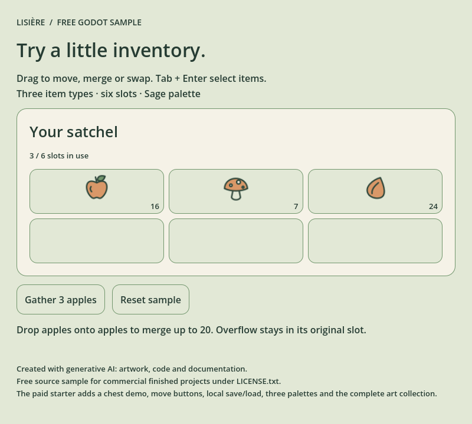

# Lisière — Free Godot Inventory Sample

A small, editable inventory for a cozy Godot prototype. **Six slots, three item types and one coherent Sage theme.** Open the project, try the stack rules, then adapt the source to your game.

**Created with generative AI:** artwork, code and documentation. This is a source-available sample under the included custom license; it is not presented as an open-source/MIT project.

**[Get the free ZIP](lisiere-ui-sample.zip)** · **[Try the larger garden example in your browser](https://lisiere-ui.onrender.com/?utm_source=github&utm_medium=sample&utm_campaign=first-customers#try)** · **[Read the integration guide](https://lisiere-ui.onrender.com/guide)**

On the ZIP file page, choose **Download raw file** (the download-arrow button).

No payment, email signup, plugin or online service is required to run the source sample. The source project makes no network calls.

## Try it in two minutes

1. Open **Get the free ZIP**, choose **Download raw file**, and extract it completely. Alternatively, use **Code → Download ZIP** for the browsable Godot source; the graphics-only files are in the included sample ZIP.
2. In the standard **Godot 4.6.1** editor, import `godot/project.godot` and wait for the SVG imports.
3. Press **F5**. Drag an item into an empty slot to move it, onto the same item to merge, or onto a different item to swap.
4. Click **Gather 3 apples**. An apple stack holds at most 20; extra apples use available slots. When there is no room, the status tells you how many were accepted.
5. Select a slot to inspect its details. **Reset sample** restores the initial state. Tab + Enter also selects controls.

Development checks used Godot 4.6.1 on Linux. Test this free source on your target setup before buying anything. Other engine versions, operating systems, touch/gamepad and web persistence are not certified.

## What is included

| Included here | What it does |
| --- | --- |
| `godot/project.godot` and `demo.gd` | Six-slot demo with three item types, add/reset and selection details |
| `godot/lisiere/inventory.gd` | Inventory rules: quantities, limits, adding, moving, merging and swapping |
| `godot/lisiere/inventory_view.gd` and `slot_button.gd` | Native Godot controls, separated from the inventory model |
| `godot/lisiere/items.json` and `theme.gd` | Editable item definitions and the Sage style |
| `sage/` in the sample ZIP | 8 icon designs + 4 UI graphics, as 12 SVGs and 36 PNGs at 1×/2×/4× |

The graphics-only sample is separate from the three icons used by the Godot demo. Size variants are not counted as extra designs.

## When the full starter is useful

The free sample is usable on its own. If the style and source fit your project, **[Inventory Starter is US$9 once, before applicable tax](https://lisiere-ui.onrender.com/?utm_source=github&utm_medium=sample&utm_campaign=first-customers)**.

The paid pack adds a 12-slot satchel + 8-slot chest demo, one/all transfer buttons, local JSON save/load, eight demo items, three editable native themes, minimal integration and garden-delivery examples, an offline HTML/JS companion, EN/FR guides and the original full graphic collection. The garden shown on the website is part of the paid source; it is not in this free ZIP. Its instant browser companion is a separate HTML/JS implementation, clearly labelled on the site.

This is a starting point for developers with basic GDScript knowledge. It does not include a complete game, crafting, equipment, multiplayer, custom integration or promised future updates. The garden has no world persistence or physics framework.

## License and feedback

Read [LICENSE.txt](LICENSE.txt). Use and modification in finished personal or commercial projects are allowed, with optional attribution. Standalone redistribution or resale as a source/asset pack is restricted. No exclusivity or copyright-protectability guarantee is made. The license and the free ZIP are unchanged from the shop sample.

If you encounter a reproducible sample problem, open an issue in this repository with your Godot version, operating system, steps and expected/actual behavior. Do not include private purchase links or payment details. [Purchase/download help](https://lisiere-ui.onrender.com/help) is available separately. Feedback is welcome; future features and updates are not promised.

## Français

Échantillon gratuit : 6 emplacements, 3 types d’objets et le thème Sage. Extraire le ZIP, importer `godot/project.godot` dans Godot 4.6.1 puis lancer F5. Déplacer, fusionner ou échanger les objets par glisser-déposer. Cet échantillon ne contient ni coffre, ni sauvegarde, ni jardin. Les fichiers sont utilisables dans vos projets finis selon la licence fournie. Visuels, code et documentation générés avec une IA.

[Guide EN/FR](https://lisiere-ui.onrender.com/guide) · [All icons](https://lisiere-ui.onrender.com/catalog) · [AI provenance](https://lisiere-ui.onrender.com/about-ai)
